# ספר כללים — PermitAgent: חזיתות וחתכים
**טיוטה 1 · 01.10.26 · סוכן 3 · לאישור אלון**

**מקורות:**
- ה-DWFX של 6 ההגשות. **רק ב-3 מהן יש גיליון חזיתות וחתכים:** כ"ט בנובמבר 1 פ"ת, פיארברג 10 חולון ושטמפפר 111-113.
- ב-DWFX של אנילביץ' 4, ביאליק 28 ונחמיה תמרי 5-7 יש רק תכניות ופרטים, בלי חזיתות או חתכים (ר' שאלה 1).
- את קובצי ה-RVT לא פתחתי.

**מקרא:**
- 🆕 נלמד מההגשות — לאישור
- ❓ שאלה פתוחה
- 🏛 משתנה לפי פרויקט

**קיצורים לפרויקטים:** כט = כ"ט בנובמבר, פיא = פיארברג, שט = שטמפפר.

---

## 0. מה העובד יעשה בחזיתות ובחתכים — הצעה
העובד לא מצייר את החזית ולא את החתך. אלה מגיעים מהמודל ומתבנית התצוגה (צבעים, קווים, הַצְלָלַת אדמה). העובד **מוסיף את הסימונים** שבהגשה ובודק שהם שלמים:
- מפלסים: יחסיים בכל רצפה, ואבסולוטיים בקרקע.
- מידות גובה.
- קווי בניין, קו מגרש ומגרשים שכנים.
- כיתובי מעקות, פרגולות ומסתורים.
- מקרא חומרי גמר וכיתובים.
- שם הקומה במרתף ושמות חללים בחתך.

הכללים הכלליים של ספר הכללים חלים גם כאן: עותק `_AGENT`, הרצה חוזרת מוחקת רק את מה שהעובד יצר (Kind `elev`), ואסור טקסט על טקסט.

---

## 1. מבנה הגיליון
- 🆕 **בכל 3 הפרויקטים:** 4 חזיתות לפי כיווני האוויר ו-2 חתכים, הכול ב-1:100 על גיליון אחד ארוך.
  - שמות החזיתות: "חזית צפונית", "חזית דרומית", "חזית מזרחית", "חזית מערבית". (כט, פיא, שט)
  - שמות החתכים: "חתך א-א" ו"חתך ב-ב". (כט, פיא, שט)
- 🏛 **הסדר על הגיליון שונה:**
  - כט ושט: שני החתכים משמאל, ואחריהם 4 החזיתות בשורה אחת.
  - פיא: החזיתות בשורה העליונה, והחתכים למטה מימין.
- 🆕 **כותרת מתחת לכל שרטוט, בפינה הימנית התחתונה:** שם השרטוט ומתחתיו קנה המידה.
  - כט: "חזית צפונית" ומתחת "1:100" בכתב קטן.
  - פיא ושט: "קנ"מ 1:100" בכתב גדול (בערך 5 מ"מ).
- 🆕 **בנוסף בגיליון:** פרטים ב-1:50 וב-1:25 (מעקה קל, פרגולה, מסתור כביסה, טרסה), כל אחד במסגרת. בפיא יש גם "פריסת גדרות". ❓ שאלה 2.

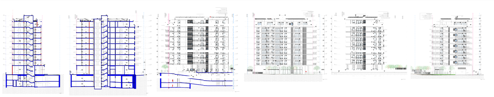
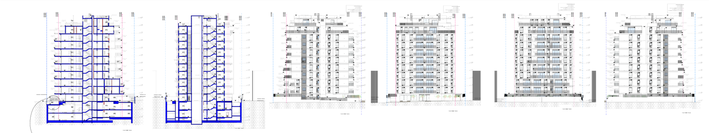
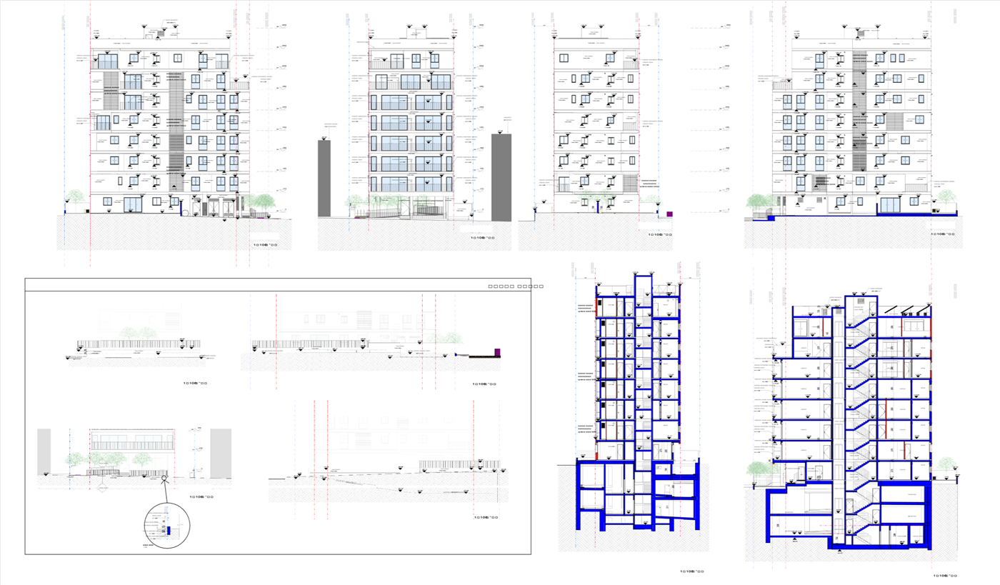

---

## 2. מפלסים
### 2א. ראשי מפלס (Level) בצד השרטוט
- 🆕 **בכל 3 הפרויקטים**, בצד השרטוט ומחוץ לקו המגרש:
  - קו מקווקו אופקי ומשולש פתוח.
  - מעל המשולש: הגובה היחסי **בס"מ, בלי נקודה** ("315", "630", "-366"). 0.00 נכתב "0".
  - לידו: שם הקומה בשתי ספרות ("00", "01" … "10").
  - קומת הגג: שט כותב "גג עליון", כט כותב "10".
- 🏛 **צד:** בחתכים של כט — משמאל. בשט ובפיא, ובחזיתות של כט — מימין.
- 🏛 **מרתפים:** שט: "-01", "-02". כט: "FP_H_-1", "FP_H_-2" — נראה כמו שם פנימי שנשאר. ❓ שאלה 3.

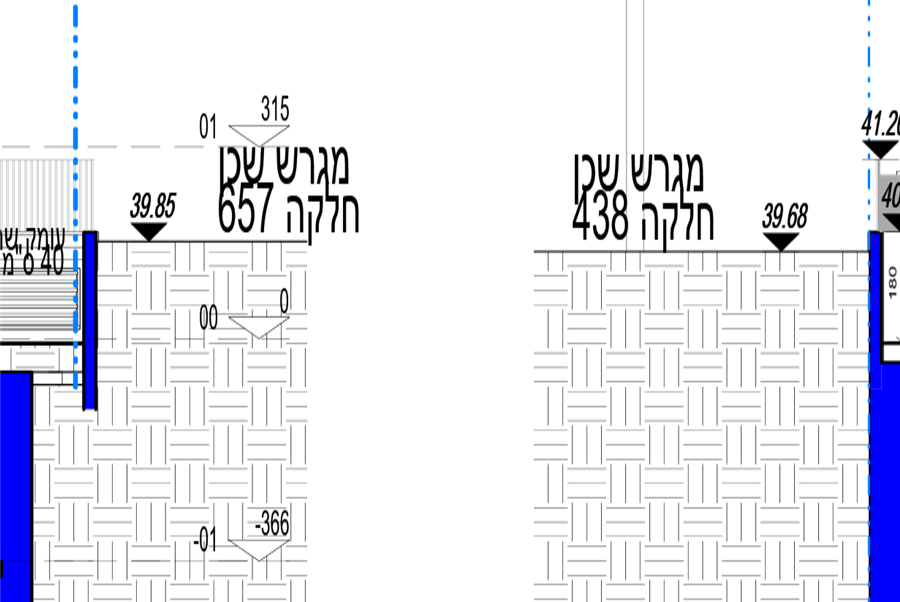

### 2ב. מפלסים נקודתיים (Spot Elevation) — יחסיים
- 🆕 **בכל 3 הפרויקטים:** משולש מלא ולידו הגובה במטרים עם סימן: "+5.20", "-3.90", "+0.00".
- 🆕 **בחתך, איפה יש מפלס (כט, פיא, שט):**
  - כל רצפה, בכל דירה או חלל שנחתך. אם יש הפרש, גם רטובים וממ"ד (‎+0.02).
  - כל מרפסת.
  - כל פודסט במדרגות.
  - גג עליון ורצפת גג טכני.
  - ראש המעקה או המעקה הבנוי בגג.
  - גג חדר המדרגות והמעלית — **הנקודה הגבוהה ביותר**.
  - ראש פרגולה.
  - רצפת כל מרתף, תחתית בור מעלית ומאגר מים.
- 🆕 **בחזית:**
  - רצפת כל מרפסת.
  - ראש מעקה בגג.
  - הנקודה הגבוהה ביותר (חדר מדרגות / מעלית).
  - **מעל ומתחת לחלונות:** משולש למטה (▼) מעל החלון ומשולש הפוך (▲) מתחתיו. (פיא, שט; בכט רק ברצפות)
- 🆕 **צפיפות:** בחזיתות של פיא ושט יש עשרות מפלסים בכל קומה. בכט פחות.

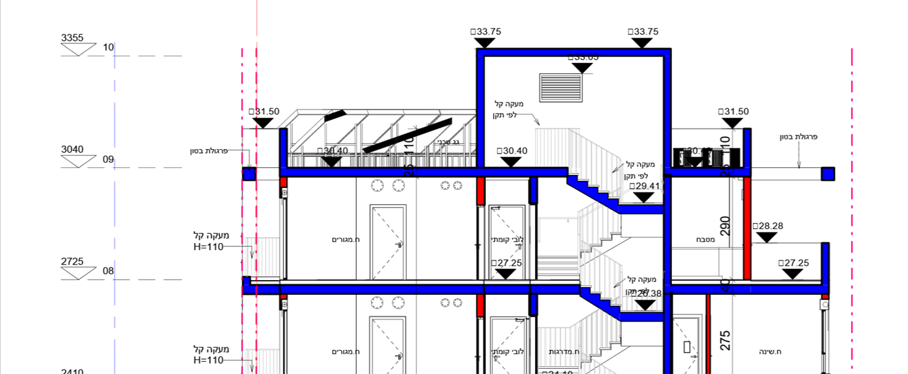

### 2ג. מפלסים אבסולוטיים
- 🆕 **בכל 3 הפרויקטים:** המפלס האבסולוטי נכתב **באותיות נטויות ומודגשות, בלי סימן** ("36.70", "39.85"). כך רואים מיד שזה לא מפלס יחסי.
- 🆕 **איפה:**
  - נקודות בקרקע לאורך החזית והחתך, כולל מדרכה וגבול מגרש. (כט, שט; בפיא בחתך)
  - קרקע במגרש השכן, עם הכיתוב "מגרש שכן / חלקה 657". (שט)
  - בפיא גם בתחתית: רצפת המרתף התחתון (26.82), תחתית יסודות (24.51), תחתית בור המעלית ומאגר המים. ובראש: הנקודה הגבוהה (63.56).
- 🏛 **גובה ±0.00 האבסולוטי לא כתוב על גיליון החזיתות** באף פרויקט.
  - בשט הוא כתוב בתכנית המגרש: "0.00=38.25".
  - בפיא, 35.21 מופיע בתכניות.
  - ❓ שאלה 4.

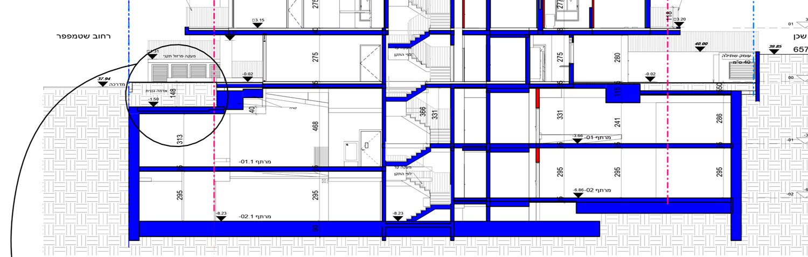
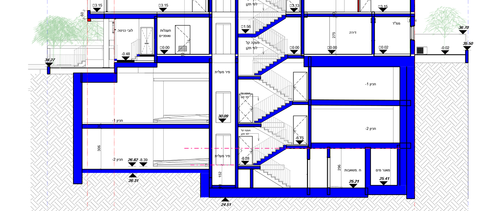

---

## 3. קרקע, גובה מקסימלי וקו גובה מותר
- 🆕 **בכל 3 הפרויקטים:** מתחת לקו הקרקע יש הצללת אדמה. היא מגיעה מתבנית התצוגה, לא מהעובד.
- ❓ **קו קרקע טבעית מול קו קרקע מתוכננת:** לא מצאתי בשום פרויקט קו נפרד של קרקע טבעית בחזית או בחתך. רואים רק את הקרקע המתוכננת ומפלסים אבסולוטיים לאורכה. שאלה 5.
- ❓ **גובה מקסימלי / קו גובה מותר:** לא מצאתי באף פרויקט קו גובה מותר, וגם לא כיתוב "גובה מקסימלי" בחזיתות. בפיא "גובה מקסימלי" מופיע רק בפרט הגדר. הנקודה הגבוהה מסומנת רק כמפלס. שאלה 6.

---

## 4. קווי בניין, קו מגרש ושכנים
- 🆕 **בכל 3 הפרויקטים**, בחזיתות ובחתכים: קווים אנכיים מנוקדים-מקווקווים לכל גובה השרטוט, ובראשם כיתוב אנכי (מסובב 90°).
  - **קו מגרש** — בכחול. כט ופיא: "גבול מגרש". שט: "קו מגרש".
  - **קו בניין** — בוורוד/אדום. "קו בניין" (כט) או "קו בנין" (פיא, שט).
  - בנוסף: "קו בניין בהקלה" (כט) ו"קו בניין קרקע" (פיא), כשיש כאלה.
- 🆕 **מגרשים שכנים:**
  - שט: מסה אפורה של הבניין השכן, "מגרש שכן / חלקה 438" ומפלס הקרקע שלו.
  - פיא: מסה אפורה בחזיתות, ו"מפלס מגרש שכן" בפריסת הגדרות.
  - כט: אין.
  - ❓ שאלה 7.
- 🆕 **שם הרחוב** בצד החתך שפונה לרחוב: "רחוב שטמפפר". (שט)

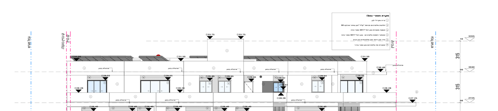

---

## 5. מידות גובה
- 🆕 **בחתך (בכל 3):**
  - שרשרת מידות אנכית בכל קומה: גובה קומה בס"מ ("275", "280", "315", "520"), והטקסט מסובב.
  - עובי תקרה בנפרד (35 / 40) — פיא, שט.
  - כט ושט מוסיפים את גובה הקומה גם בתוך החלל.
- 🏛 **בחזית:**
  - כט: שרשרת גבהי קומה בצד ("315", "520"), וגובה אדן מעל רצפה ("105").
  - פיא ושט: אין מידות בחזית, רק מפלסים.
  - ❓ שאלה 8.
- 🏛 **גובה מעקה נכתב בכיתוב, לא כמידה, וביחידות שונות:**
  - כט: "מעקה קל H=110".
  - שט: "מעקה קל H=105".
  - פיא: "מעקה פרופיל מתכת גוון כהה H=1.05" (במטרים).
  - ❓ שאלה 9.

---

## 6. מרתפים בחתך ובחזית
- 🆕 **בחתך — בכל 3:** המרתפים מוצגים במלואם, בתוך הצללת האדמה, עם מפלס בכל רצפה ושם החלל.
  - כט: "מיסעה".
  - פיא: "חניון -1", "חניון -2", "ח.משאבות", "מאגר מים".
  - שט: "מרתף -01", "מרתף -02.1".
- 🏛 **בחזית:**
  - כט: גם המרתפים מוצגים, בחתך דרך האדמה, עם הרמפה והמפלסים שלהם.
  - פיא ושט: החזית נגמרת בקו הקרקע, ומתחתיו רק הצללת אדמה.
  - ❓ שאלה 10.

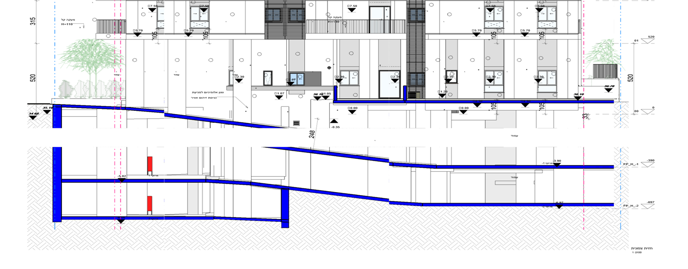

---

## 7. שמות חללים בחתך
- 🏛 **שונה בין הפרויקטים:**
  - כט: שם מלא לכל חלל, כמו בתכנית ("ח.מגורים", "לובי קומתי", "ח.מדרגות", "ח.שינה", "מטבח", "לובי", "מפלס ביניים").
  - פיא: שם כללי — "דירה", "ממ"ד", "פיר מעלית", "לובי כניסה", "עגלות ואופניים", "חניון -1".
  - שט: בקומות כמעט אין שמות. במרתפים: "מרתף -01".
  - ❓ שאלה 11.
- 🆕 **בגג (כט, פיא):** "גג טכני" על רצפת הגג, ובפיא גם "פתח שחרור עשן 80/80" עם חץ.

---

## 8. חומרי גמר וכיתובים
- 🏛 **שתי שיטות:**
  - **מקרא + מספרים** (כט, שט): במסגרת בפינה העליונה של **כל** חזית כתוב "מקרא חומרי גמר", ובו רשימה ממוספרת (למשל: 1 טיח אקרילי לבן, 2 חלונות אלומיניום… גוון שחור אוניקס, 3 מעקה מסגרות גוון RAL 9017). על כל משטח בחזית — עיגול קטן עם המספר.
  - **כיתוב ישיר** (פיא): על כל משטח כתוב "טיח בגוון White Extra", ו"מסתור כביסה אלומיניום גוון בהיר RAL 9016" עם חץ.
  - ❓ שאלה 12.
- 🆕 **כיתובים שחוזרים בכל 3 הפרויקטים**, עם קו מנחה וחץ:
  - "מעקה קל H=…" — במרפסות.
  - "מחיצה בין מרפסות / זכוכית חלבית H=180". (פיא, שט)
  - "פרגולה קלה" / "פרגולת בטון" / "פרגולה בטון בנויה".
  - "מעקה קל לפי תקן" — במדרגות, בחתך.
  - "מ.בנוי H=150" — מעקה בנוי בגג. (פיא)
  - "ערוגת נוי", "אדמה גננית", "עומק שתילה 40 ס"מ". (כט, שט)

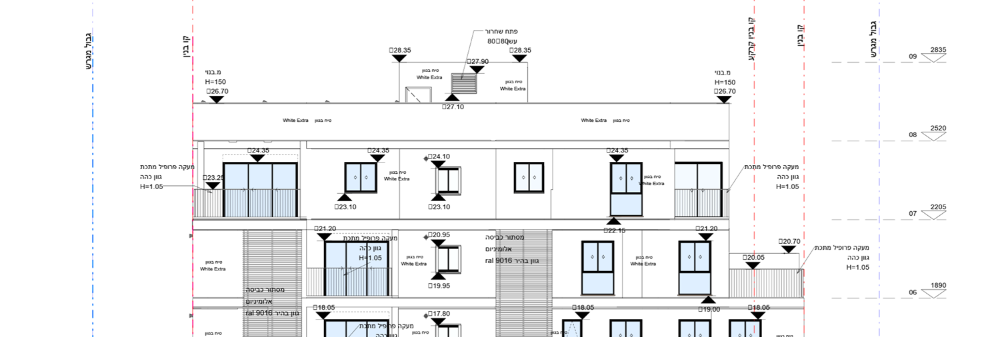
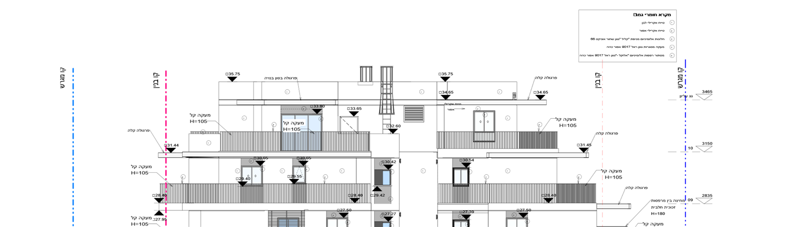

---

## 9. גג ומתקנים טכניים
- 🆕 **מה מופיע (כט, פיא, שט):**
  - חדר מדרגות ומעלית שבולטים מעל הגג, עם מפלס בראשם.
  - פרגולה מעל הגג העליון.
  - קולטים או פאנלים משופעים ("גג טכני").
  - רפפות אוורור, ארובות וסולם.
- ❓ **מסתור למתקנים טכניים:** לא ראיתי כיתוב או מפלס נפרד למתקנים, מעבר למעקה הגג. שאלה 13.

---

## 10. סגנון
המידות כאן משוערות מתוך התמונות.
- 🆕 **טקסט רגיל — כ-2 מ"מ:** מפלסים, כיתובים, ראשי מפלס ושמות חללים. כנראה אותו סוג "2.0 mm" כמו בתכניות.
- 🆕 **מקרא חומרי גמר** (כט, שט): קטן יותר, כ-1.5 מ"מ.
- 🆕 **כותרת וקנ"מ:** כ-5 מ"מ. בכט הכותרת קטנה יותר.
- 🆕 **צבעים:** בטון חתוך בכחול מלא, בלוקים באדום, קו מגרש כחול, קו בניין ורוד. כל אלה מתבנית התצוגה, ולא באחריות העובד.
- 🆕 **ריווח:** כיתובי המעקות יושבים מחוץ לבניין, משני צדיו, בגובה המרפסת. המפלסים יושבים על הרצפה עצמה. בחזיתות של פיא ושט הצפיפות גבוהה, וכאן הבדיקה "טקסט על טקסט" חשובה במיוחד.

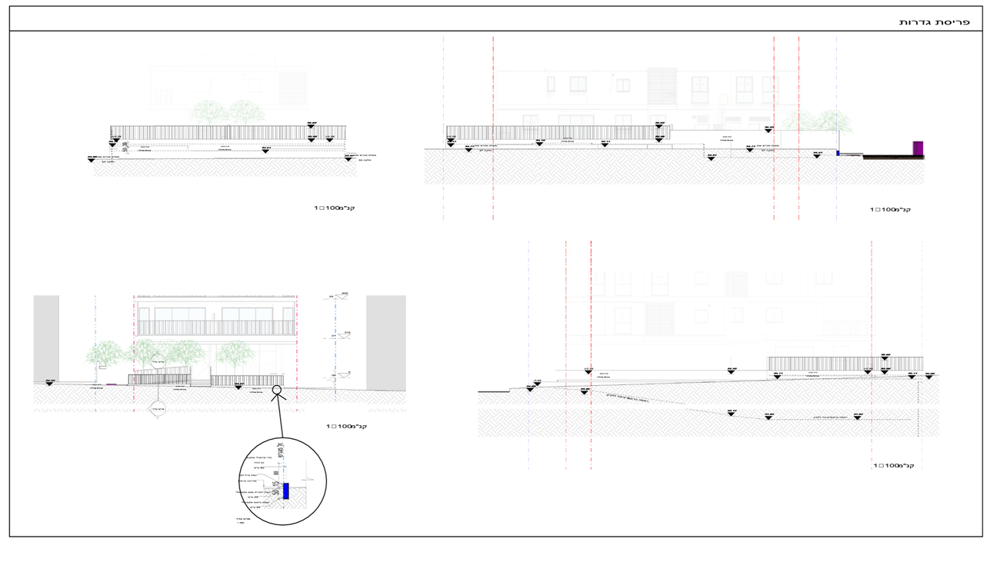

---

## ❓ שאלות מרוכזות
1. **ב-DWFX של אנילביץ', ביאליק ונחמיה תמרי אין חזיתות וחתכים.** האם הם הוגשו בקובץ נפרד? אם כן, אשמח לקבל אותו.
2. **מה בתחום העובד בגיליון החזיתות?** רק 4 החזיתות ו-2 החתכים, או גם הפרטים (מעקה, פרגולה, מסתור) ופריסת הגדרות?
3. **שמות קומות המרתף בראש המפלס:** "-01", "-02" כמו בשט? (בכט כתוב "FP_H_-1".) והגג — "גג עליון" או מספר הקומה?
4. **±0.00 אבסולוטי:** לכתוב על כל חזית וחתך "±0.00 = 38.25"? אם כן, איפה — ליד ראש המפלס 00 או ליד הכותרת?
5. **קרקע טבעית:** לצייר קו קרקע טבעית (מקווקו) בנוסף לקרקע המתוכננת? מאיפה העובד ייקח אותה — Toposolid קיים או נקודות מהמדידה?
6. **גובה מקסימלי וקו גובה מותר:** לסמן קו גובה מותר לפי התב"ע וכיתוב "גובה מקסימלי"? מאיפה העובד יקח את הערך — פרמטר בפרויקט או שאלה בכל הרצה?
7. **מגרשים שכנים:** לכתוב "מגרש שכן / חלקה X" ומפלס הקרקע שלו בכל חזית וחתך, כמו בשט? ומסה אפורה של בניין שכן — האם היא מהמודל או שהעובד צריך ליצור אותה?
8. **מידות בחזית:** להוסיף שרשרת גבהי קומות בצד החזית (כמו בכט), או להסתפק במפלסים (פיא, שט)?
9. **גובה מעקה:** H=105 או H=110? ובס"מ ("H=105") או במטרים ("H=1.05")? האם לקחת את הגובה מהמודל?
10. **מרתפים בחזית:** להציג אותם מתחת לקרקע (כמו בכט) או לא (פיא, שט)?
11. **שמות חללים בחתך:** שם מלא כמו בתכנית (כט), שם כללי "דירה" / "ממ"ד" (פיא), או בלי שמות (שט)?
12. **חומרי גמר:** מקרא ממוספר + עיגולים על החזית (כט, שט), או כיתוב ישיר על כל משטח (פיא)? ואם מקרא — מהיכן הרשימה: מהחומרים במודל או רשימה קבועה של המשרד?
13. **מתקנים טכניים על הגג:** לסמן אותם ואת גובה המסתור שלהם בנפרד?
14. **מפלסים מעל ומתחת לחלונות בחזית** (פיא, שט): חובה, או רק ברצפות ובמרפסות (כט)?
15. **כותרת השרטוט:** "חזית צפונית" + "קנ"מ 1:100" — האם העובד בודק או משנה את שם התצוגה, או שזה נשאר מהגיליון כמו שהוא?
16. **הכיוון:** שמות החזיתות לפי כיוון צפון במודל — האם העובד צריך לבדוק שהשם תואם לכיוון האמיתי?
